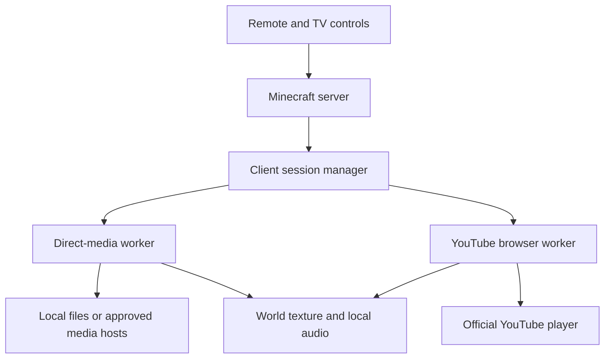

# Minecraft Television Mod — Research and Full Implementation Brief

**Prepared:** 25 October 2026  
**Working name:** EraTV  
**Target:** Minecraft Java Edition 1.20.1 · Forge 47.x · Java 17  
**Launch platforms:** Windows and GNU/Linux, initially x86-64  
**Document purpose:** Hand this document to a coding agent to build, test, package, and document the mod. This is an implementation specification informed by source research, not a claim that the native playback prototypes have already been built or tested.

Unless explicitly identified as a documented finding, the architecture, behavior, defaults, thresholds, and milestones below are proposed design requirements.

## 1. Decisions and intended outcome

The user confirmed:

- **Forge 1.20.1** for the first release.
- **Windows and Linux** support.
- **Supported sources first:** working TVs and supported video playback may ship before subscription-service integration. Netflix, Hulu, Crunchyroll, and Prime Video must be assessed separately and enabled only after their actual feasibility is established.

Proceed with these additional design assumptions unless the project owner changes them:

- Support single-player, LAN, and dedicated multiplayer servers.
- Make an independent mod with no mandatory MCA, furniture, energy, or automation dependencies.
- Give it a vanilla-compatible appearance with distinctive televisions from six eras and a usable handheld remote.
- Keep native media/browser runtimes on clients. The Minecraft server manages furniture, permissions, channels, and playback intent.
- Each participating client obtains its own media from an authorized source. The server does not relay a player's subscription video or account.
- Start with Windows 11 and current Linux x86-64 testing, including Arch/CachyOS with Hyprland. Test Windows 10 compatibility where the selected runtimes still support it; publish the precise tested OS matrix.
- Treat ARM, macOS, Fabric, NeoForge, Bedrock, and mobile launchers as later ports.
- Use **EraTV / `eratv`** provisionally. Check naming and settle registry identifiers before the first public world saves depend on them.
- Default new project code to MIT unless an existing repository specifies otherwise. Preserve every dependency's separate license and obligations; do not relicense upstream code.

**The desired experience:** a player places a television, pairs a remote, chooses a channel or video, and watches it on the physical screen. Nearby consenting players can join the same session. Older sets have appropriate shapes, controls, and optional period effects; newer sets offer larger displays. A source that cannot play explains why and offers a useful next action.

**Do not describe an external-browser launcher as in-world streaming support.** Subscription-service shortcuts are useful, but they are a separate, explicitly labeled capability.

## 2. What the research establishes

Sources are listed in section 25. Findings describe retrieved documentation as of the date above. Actual runtime/provider compatibility still requires the tests in section 4.

| Finding | Evidence and implication |
| --- | --- |
| Browsers can be rendered into Minecraft screens. | WebDisplays demonstrates an existing MCEF-based approach. This establishes the general technique, not compatibility with every service. [S1, S2] |
| A Forge 1.20.1 MCEF release exists. | The published Forge artifact is `2.1.6-1.20.1`. Its presence is useful for comparison and prototyping. [S3] |
| The main MCEF repository advertises Chromium `116.0.5845.190`. | Do not make that browser build the production internet-facing runtime by default. Verify the binaries themselves and their security maintenance; a Minecraft-compatible JAR alone is insufficient. [S2] |
| A considerably newer JCEF distribution is available. | jcefmaven lists `152.0.6`, with a release identifying Chromium `152.0.7977.83`. This is a candidate to test, not a prevalidated Minecraft dependency. [S4, S5] |
| YouTube provides an official embedded player and documented controls. | Use the IFrame Player API. Its documented errors cover disabled embedding, unavailable videos, playback failures, and missing client identification. [S6] |
| YouTube integration has presentation and playback constraints. | Minimum viewport size, identification, player visibility, overlays, and automatic playback rules materially affect a television mod. Preserve the official player. [S7, S8] |
| Widevine is not categorically unavailable in CEF. | Google's platform table includes CEF/Electron, and use of Widevine products/services requires an agreement. This does **not** establish that an ordinary MCEF/JCEF build can play Netflix. [S9] |
| DRM support does not establish access to a subscription provider. | EME is an interface to key systems. Provider authorization, account entitlement, device support, codecs, and the permitted video-output path remain separate requirements. Protected media may be unavailable to ordinary media-copy APIs. [S10] |
| Provider browser requirements are specific and can disagree across help articles. | Netflix documents supported browsers and Linux limitations. Prime Video lists supported browsers and limits non-Windows/non-macOS browser playback to SD. Crunchyroll pages retrieved give differing browser minimums. Hulu's retrieved guidance discusses supported Mac/PC browser use; Linux support was not established. [S11–S16] |
| A native direct-media backend is viable independently of a browser. | GStreamer supplies playback pipelines and application-facing audio/video sinks; its Java bindings document Windows/Linux support. Package and test the needed plugins. [S17–S21] |
| Apparently convenient media libraries have different licenses. | WaterMedia's inspected `2.1.x` license is PolyForm Strict; vlcj advertises GPL/commercial licensing. Neither should silently be treated as a permissive drop-in dependency. [S22, S23] |

### 2.1 Source support commitments

| Source | First-release treatment | Multiplayer behavior |
| --- | --- | --- |
| Bundled original demo clip | Required; works offline once the media runtime is installed | Every client already has the same asset |
| Local WebM files | Required; VP8/VP9 with Opus/Vorbis according to tested codec matrix | Local-only by default; an explicit shared asset ID can map to independently imported matching files |
| Public HTTPS WebM | Required | Each client fetches the same approved resource |
| Public HTTPS MP4 | Required target for common H.264/AAC files, conditional on the exact shipped decoder/plugin combination being distributable and tested | Each client fetches independently; unsupported codec combinations report a precise error |
| Unencrypted HLS VOD/live | Implement for first release after progressive playback; supported combinations must be listed | VOD uses timeline synchronization; live uses measured live-edge behavior |
| YouTube videos with embedding enabled | Required for the full “direct video + YouTube” release; official player only; browser qualification is a release gate | Shared content/control intent, with client-specific ads, buffering, and restrictions; best-effort synchronization |
| Netflix | Research-gated; external-browser shortcut may ship | No shared stream or account; no automatic watch-party claim |
| Hulu | Research-gated; verify Windows and Linux separately | Same restrictions as above |
| Crunchyroll | Research-gated; do not assume its anime catalog is an ordinary direct-video source | Same restrictions as above |
| Amazon Prime Video | Research-gated; external-browser shortcut may ship | Same restrictions as above |
| Arbitrary websites, IPTV playlists, torrents, DASH, Twitch, screen capture | Outside the initial supported-source set | Add only through separate adapters and explicit qualification |

“MP4 support” is not “every file ending in .mp4.” Containers, codecs, profiles, bit depths, audio formats, and transport behavior all matter. Expose detected capability instead of guessing from an extension. [S24]

If YouTube qualification fails, continue the independent direct-media work. A media-only build can be released with an accurate feature list, but it does not satisfy the complete YouTube milestone. Record the remaining blocker and its reproducible evidence.

## 3. Technical direction

Use a **Forge mod plus two optional client playback adapters**:

1. **Direct media:** a GStreamer worker, using `gst1-java-core` and curated native plugins.
2. **YouTube:** a current JCEF/CEF worker running a small controlled wrapper around the official player.

Launch workers outside the Minecraft JVM. This avoids forcing browser UI/toolkit dependencies into Minecraft and allows a native worker crash to become a recoverable TV error. Process separation is crash isolation; it is not automatically a complete security sandbox.

The core mod must load and dedicated servers must start with neither playback runtime installed. Clients without a runtime can still place furniture, operate permitted shared controls, and see an installation/help state.

| Option | Decision |
| --- | --- |
| Unmodified MCEF 2.1.6 | Reference/prototype only until its actual runtime, patch status, and sandbox are qualified |
| Maintained MCEF fork with a current runtime | May replace the browser worker integration only if section 4 proves equivalent functionality, security, maintenance, and coexistence |
| Current JCEF/CEF worker | Preferred browser route; isolate it from Minecraft's LWJGL and classpath |
| GStreamer worker | Preferred direct-media route; keeps direct media independent of YouTube and CEF codec support |
| WaterMedia | Do not make mandatory or copy its code/assets under an assumed open-source license |
| LibVLC/vlcj | Alternative only through an architecture decision that addresses binding and plugin licenses |
| Windows WebView2 | Possible later Windows-specific adapter; does not meet the Linux launch requirement by itself |
| Capturing a normal browser window | Not the subscription-service solution; capture/output restrictions and privacy remain unresolved |
| A browser running on the Minecraft server and streaming frames to everyone | Excluded from this design |

Avoid an engine rewrite, a general-purpose browser, a content aggregation service, and server-side transcoding. Build the smallest media host that meets the declared source capabilities.

Do not pin “latest” dynamically. The first dependency decision must record exact Java artifacts, CEF/JCEF/native versions, GStreamer/plugins, platform builds, hashes, licenses, and verified startup requirements. Recheck the candidates in this document at implementation time.

## 4. Start with feasibility gates

Before detailed furniture polish, create a small test harness and one temporary TV block. Complete these gates in order; retain the results in `docs/feasibility.md` and `docs/dependency-matrix.md`.

### Gate A — clean Forge and client/server separation

- Create a Forge 47.x / Java 17 project using a reproducible Gradle wrapper.
- Start an integrated client and a headless dedicated server.
- Ensure no common/server class imports a client renderer, browser class, GStreamer class, AWT, or a native loader.
- Verify the same core mod works with missing client playback packages.
- Pin an actual supported Forge patch version; do not assume examples written for later loaders apply. [S25–S28]

**Pass:** both starts succeed; a server never downloads or initializes a browser/media runtime.

### Gate B — direct video to an actual world texture

- Play an original, licensed 60-second WebM with motion, frame numbers, color bars, stereo markers, and timed captions.
- Send frames from the worker into a Minecraft dynamic texture.
- Exercise pause, seek, resume, restart, EOF, malformed media, and worker termination.
- Verify color order, orientation, stride, aspect ratio, timestamps, buffer ownership, and bounded memory.
- Repeat on Windows and Linux before selecting the transport/pixel format permanently.

**Pass:** visible, audible, stable playback; no main-thread decoding; no crash or orphan after worker death.

### Gate C — direct audio timing and location

- Implement the audio-clock strategy in section 15.
- Measure lip-sync with flash/beep markers and a moving player.
- Confirm there is exactly one audible output, the Minecraft master/media volume works, mute is immediate, and reconnect/device changes recover.
- Demonstrate no cumulative drift over 30 minutes.

**Pass:** measured steady-state audio/video offset meets section 22; no unbounded queue growth.

### Gate D — current browser off-screen rendering

- Test the current candidate JCEF build in a separate worker on Java 17.
- Prove off-screen paint callbacks can supply pixels without putting an AWT window or JOGL renderer inside Minecraft.
- If JCEF's default OSR implementation requires extra module flags or a rendering extension, confine that to the worker and document it.
- Test keyboard, Unicode text, pointer events, DPI, resize, popup handling, and supported browser sandbox operation.
- Use current CEF documentation and the selected headers; do not infer exact callback signatures from a Minecraft mod tutorial. [S4, S29, S30]

If the Java binding cannot provide the required sandbox and off-screen path, evaluate a minimal native CEF worker using the same IPC contract. Do not disable the sandbox to preserve the preferred binding. This fallback changes the host implementation, not the source model or Forge architecture.

**Pass:** no visible helper window, current runtime, working off-screen pixels, and supported sandbox operation on both platforms. An installed system Chrome browser does not count as satisfying this gate.

### Gate E — real official YouTube playback

Test an embeddable video owned by the project or otherwise suitable for testing:

- Real client identity/referrer, the official IFrame API, successful sound/video, controls, captions, and links.
- A normal video, embedding-disabled video, unavailable video, live video, an ad-supported session where available, autoplay rejection, and error 153.
- Visibility restrictions, a small/distant in-world screen, and the enlarged viewing mode.
- Network policy that preserves required player, CDN, and advertising requests while blocking private-network access.
- An ordinary packet capture of control traffic must contain no account cookies or media payload.

**Pass:** the official player works on both supported platforms with the constraints in section 12. Do not bypass failed identification or embedding restrictions with URL extraction.

### Gate F — two clients and degraded conditions

- One dedicated server, two clients, independent playback.
- Introduce 150 ms latency, variable buffering, reordered stale application messages, and a server running at 10 TPS.
- Verify controller permissions, late join, pause, seek, destruction/replacement, dimension changes, and reconnect.
- Measure direct-media synchronization separately from YouTube's best-effort behavior.

**Pass:** direct-media targets meet section 22, and client-specific failures do not stall or commandeer everyone else's session.

### Gate G — distributable installations

- Test fresh Windows/Linux user profiles with no development checkout or system VLC.
- Verify runtime installation, cancellation, interrupted download, checksum failure, offline operation after installation, rollback, and uninstall.
- Prove Linux operation under Hyprland/Wayland with the selected supported backend; an XWayland dependency is acceptable if detected and documented.
- Record the minimum glibc/native dependencies from the actual packaged binaries.
- Finish the dependency/plugin license inventory.

**Pass:** a user can install through the documented path without root access, antivirus disabling, arbitrary shell scripts, or a development SDK.

### Gate H — subscription-service evidence

This is a separate research milestone, not a prerequisite for completing direct-media development. Follow section 13 and produce a status for each provider, including a reason when integration is blocked. No subscription provider moves to “Supported” merely because its homepage or a DRM test clip loads.

## 5. Televisions, models, and survival content

### 5.1 Six launch models

Era names describe visual inspiration, not exact historical reproductions. Create original designs without manufacturer logos.

| Registry ID | Era and appearance | Occupied footprint, W × H × D | Media aperture |
| --- | --- | --- | --- |
| `eratv:wooden_monochrome_tv` | 1950s wooden console; cloth speaker grille, large knobs, thick rounded bezel | 2 × 2 × 1 | 4:3 |
| `eratv:woodgrain_color_tv` | 1970s woodgrain cabinet; inset glass, silver trim, channel dial | 2 × 1 × 1 | 4:3 |
| `eratv:portable_tv` | 1980s compact plastic set; handle, telescopic antenna, side speaker | 1 × 1 × 1 | 4:3 |
| `eratv:crt_tv` | 1990s dark plastic CRT; deep rear housing, buttons, status LED | 2 × 2 × 1 | 4:3 |
| `eratv:plasma_tv` | 2000s thick flat panel; silver/dark frame, broad pedestal | 3 × 2 × 1 | 16:9 |
| `eratv:oled_tv` | Modern slim panel; narrow frame, feet or wall-mount option | 3 × 2 × 1 | 16:9 |

The footprint is the occupied grid volume, not a direction to stretch the video across the entire rectangular block region. Define the aperture, bezel, collision shape, and physical depth in model units. Keep the original content aspect ratio through letterboxing/pillarboxing.

All models accept the same supported sources. Their differences are appearance, aperture, and optional presentation settings. Do not hide YouTube behind an upgrade, subscription, advancement, or in-game payment.

### 5.2 Multi-block rules

- Use a single logical TV ID and controller block entity per assembled TV.
- Occupancy/part blocks reference the controller; only the controller owns playback state.
- Placement validates all required positions, dimension bounds, replaceability, permissions, and wall support, then commits atomically.
- Rotation transforms footprint, hitboxes, screen plane, support checks, and interactions consistently.
- Breaking any part removes the assembly exactly once and drops one television item.
- Handle explosion, support loss, chunk boundaries, save/reload, corrupted/missing parts, and creative cloning without duplicate drops or ghost parts.
- Do not force-load missing chunks to repair an assembly. Repair when the relevant chunks are naturally available.
- Block piston movement by default. External contraptions/moving-structure mods are unsupported until explicitly integrated.
- Wall-mount mode is an alternate placement configuration for the flat panels. Show a placement outline before committing.

Do not implement oversized geometry that looks occupied but can be built through because only one invisible anchor has collision.

### 5.3 Visual and sound identity

- Use Minecraft-scale pixel textures, restrained material shading, and readable silhouettes.
- Create source models in Blockbench-compatible form plus exported game models.
- Include readable inventory models, particle textures, blockstates, loot, recipes, English language keys, and an original icon.
- Animate knobs/buttons locally in response to confirmed state changes.
- Optional CRT/monochrome effects are for direct media and the demo source. Disable content-altering effects for the YouTube player.
- Apply curvature to the housing/glass design without hiding or clipping the official YouTube player rectangle.
- Provide “Authentic picture” and “Clear picture” options for eligible direct media; accessibility controls can disable flicker, grain, scanlines, startup sounds, and hum.
- No flashing static by default. Use a calm standby/test-card image.
- Keep full-bright emission confined to the screen. Do not run expensive dynamic world-light updates for every video frame.

### 5.4 Recipes and progression

Use vanilla ingredients and data-generated JSON recipes. A reasonable starting balance:

- Remote: copper, redstone, quartz, stone button.
- Wooden console: planks, glass, copper, redstone, note block.
- Woodgrain color set: wooden console plus redstone and dye; retain a direct crafting recipe for modpack flexibility.
- Portable: iron, glass, copper, redstone.
- CRT: iron, glass, redstone, quartz.
- Plasma/OLED: progressively more glass, quartz, copper, and redstone components.

Choose exact shaped layouts during implementation, test their crafting behavior, and include recipe-book unlocks. Avoid requiring scarce netherite, invented power systems, or disposable batteries for basic viewing.

Add advancements for crafting a television, pairing a remote, and successfully playing the included demo. Never award advancements for watching ads, signing into an external service, or increasing YouTube view counts.

## 6. Remote and physical controls

### 6.1 Universal remote

Implement `eratv:remote_control`:

- Sneak-use a TV to pair.
- Use in the air to open the remote for the paired TV.
- Ordinary use on a different TV offers a clear switch/pair action rather than silently changing the binding.
- A remote stores the TV's persistent UUID, world/server namespace, dimension, and a display label. Coordinates are a hint, not identity or authority.
- Default control range: 32 blocks in the same dimension. Enforce it on the server.
- A lost/replaced TV shows “TV unavailable” and an unpair option. It never controls a newly placed TV solely because coordinates match.
- Pairing does not grant permission. A copied remote cannot bypass the TV's ACL.
- Pairing and labels survive normal saves; cross-server use fails safely.
- Put basic power/source controls on the TV itself so a lost remote is recoverable.

The initial release needs one robust universal remote. Multiple historical remote items are optional later cosmetics.

### 6.2 Remote layout and behavior

Provide Power, Home, Back, directional navigation, Select, Play/Pause, Stop, ±10-second seek when available, Previous/Next channel, Captions, Volume, and Local Mute.

Distinguish these operations in the UI:

| Operation | Authority |
| --- | --- |
| Shared source, channel, playback, seek, power | Server-approved controller |
| TV speaker level | Shared setting; authorized controller |
| “Mute for me,” personal volume ceiling, captions, audio language, quality | Local viewer |
| Joining/leaving a viewing session | Local viewer |
| Opening a provider account or external browser | Local player action only |

Disable unsupported actions with an explanation. Live streams do not automatically have seek or pause support. Local pausing because the TV is hidden must not broadcast a global Pause.

Use `AcquireControlLease` for shared controls: a renewable short lease prevents two remotes from fighting. Owner/operator can reclaim it; disconnect and inactivity expire it. The shared controller is not a trusted source of arbitrary server facts.

### 6.3 Permissions

Default owner-only editing. Offer:

- Owner: settings, ACL, source, channels, playback.
- Explicit trusted players: configurable playback and channel editing.
- Public viewers: may join and control their own local preferences.
- Optional public playback controls: off by default.
- Operator override and administrative reset.

Never use client-supplied ownership fields or a remote's NBT as permission proof. Recheck distance, dimension, identity, role, loaded assembly, and control lease for each mutation.

## 7. Player interface and onboarding

### 7.1 First-use flow

1. Place a TV; the screen shows a clean standby face.
2. Use it to see “Watch,” “Choose source,” and “Settings.”
3. If a required runtime is absent, explain its size/platform and offer the supported installation path.
4. Offer the bundled demo first.
5. Before an external source loads, explain that the player's computer will connect to the named service/host. Remember scoped trust decisions.
6. A multiplayer TV initially shows its title/source and “Join viewing.” It must not fetch external media solely because its chunk became visible.

Trust decisions must be local. A server can narrow allowed sources but cannot turn on a player's networking, account login, autoplay, or local-file access.

A source change to a new, untrusted host requires new local consent before any request. A remembered grant may cover subsequent videos from the same approved provider/server context, but must remain visible and revocable. Validate redirects and secondary resources even after consent.

### 7.2 Source picker

Tabs:

- **Channels:** server-approved numbered entries.
- **Video link:** supported direct media or a recognized YouTube URL.
- **My files:** local picker and imports.
- **YouTube:** paste link; optional official search only after the separate search feature is configured.
- **Services:** Netflix, Hulu, Crunchyroll, Prime Video, each with truthful status and actions.

Show source mode plainly: “In-world playback,” “Open in browser,” “Experimental,” or “Unavailable on this platform.” Do not put a functioning-looking Play button on an unsupported subscription tile.

Favorites and recent local history are private by default. Shared channels are intentionally public to eligible participants. Do not broadcast someone's browser history or account identity as TV metadata.

### 7.3 Viewing and accessibility

- Provide an enlarged viewing screen tied to the world TV, with the remote controls beside the content.
- Preserve the complete official player and its controls. Keep native overlays, tooltips, crosshair, and mod UI outside that rectangle while interacting.
- Keyboard access, remappable input, GUI scaling, narration for mod controls, readable focus indicators, and a high-contrast mode are required.
- Escape releases browser input before closing the screen; it never leaves Minecraft movement keys stuck.
- IME/Unicode input, paste, Alt-Tab, window resizing, and F3+T must be tested.
- Captions/language are per viewer. Use provider UI when its API does not expose the needed control.
- Provide a global “Disable external media” switch and a global local mute.

### 7.4 Useful failure messages

| Situation | Message/action |
| --- | --- |
| Runtime missing | “Video playback needs an additional component.” Install / setup help |
| Local file absent | “This video is stored on another player's computer.” Select matching file |
| Unsupported codec | Identify the unsupported video/audio codec and supported alternatives |
| YouTube embedding disabled | “This video cannot play in embedded players.” Open on YouTube |
| Autoplay blocked | “Press Play to start watching.” Actual local player interaction |
| YouTube error 153 | “YouTube could not identify this player.” Retry / diagnostic code |
| Subscription unsupported | “This service currently opens in your browser.” No in-world support claim |
| Unauthorized remote | “Only the owner or trusted players can change this TV.” |
| Buffering | Show local buffering status, not a false global failure |
| Policy-blocked address | Explain the blocked host category without exposing secret query strings |
| Worker crash | “Playback stopped unexpectedly.” Retry player / copy redacted diagnostics |

Keep technical identifiers in an expandable diagnostic panel. Avoid permanent toast loops, repeated narration, and automatic browser-opening retries.


## 8. Modules and responsibilities

Keep Minecraft gameplay, source descriptions, and native playback separate.

| Module/package | Responsibilities |
| --- | --- |
| `eratv-core` | Pure Java source descriptors, capabilities, validation, state machines, synchronization math, protocol schemas |
| `eratv-forge` | Registration, blocks, items, menus, recipes, persistence, permissions, commands, Forge network channel |
| `eratv-client` | TV renderers, client session manager, GUI, worker supervision, texture uploads, local trust and settings |
| `eratv-media-worker` | GStreamer backend and controlled media ingestion; no Minecraft dependency |
| `eratv-browser-worker` | Current JCEF/CEF, official YouTube wrapper, browser request policy; no Minecraft dependency |
| `eratv-runtime-packaging` | Per-platform bundles, manifest generation, hashes, notices, packaging smoke tests |
| `eratv-test-fixtures` | Original media, HTTP test service, malformed manifests, simulated provider events |
| `docs` | User/admin setup, support matrix, privacy, architecture decisions, test evidence, maintenance instructions |

Prefer a Gradle multi-project repository, with the distributable Forge JAR containing gameplay/client integration and separately versioned workers/runtime packages. An equivalent structure is acceptable if dependency boundaries are enforced.



The arrows to internet sources represent client-side traffic. No media bytes pass through the Minecraft server.

### 8.1 Main interfaces

Use typed domain objects, not strings of arbitrary commands:

- `MediaSource`: provider, public content identity, safe display label, transport class, source revision.
- `PlaybackCapabilities`: play, pause, seek, live/DVR, rate control, tracks, captions, output type, effect eligibility, synchronization mode.
- `PlaybackBackend`: asynchronous prepare/start/pause/seek/stop/close; local volume/input operations; capability and status events.
- `FrameSink`: bounded frame delivery with width, height, stride, format, timestamp, slot, sequence, and generation.
- `AudioSink`: direct-media PCM delivery and presentation feedback; not used to extract YouTube audio.
- `ProviderPolicy`: accepted URL forms, identity rules, network origins, visibility requirements, error mapping.
- `ClientPlaybackSession`: desired server state plus independent local availability, consent, runtime, and observed playback state.
- `TvSessionService`: server authority for logical TV sessions.
- `RuntimeSupervisor`: verified process launch, heartbeat, crash recovery, resource limits, teardown.

Do not give a provider adapter a Minecraft server command executor, arbitrary file access, raw Java reflection bridge, or a general-purpose “execute JavaScript” network message.

### 8.2 Capability-driven actions

Capabilities are established by the backend and the loaded content. They may change after metadata loads.

Examples:

- A progressive file without usable random access can play while Seek is unavailable.
- A live HLS source can expose a live edge without VOD-style duration.
- YouTube can allow seek for a VOD but provide limited control for another content type.
- A missing audio decoder can produce a clear error rather than silent success.

The UI intersects backend capability, source capability, provider policy, local preference, and server permission. An API method existing in Java is not sufficient to expose a player action.

## 9. Persistent state, identity, and network protocol

### 9.1 Separate three layers of state

**World-persistent TV state:**

- Schema version, TV UUID, model ID, assembly anchor and orientation.
- Owner UUID, trusted-player roles, public-control setting.
- Display name, logical power, selected channel, redstone mode.
- Shared source descriptor and queue/channel references.
- Saved VOD cursor and intended playback mode.
- Shared speaker gain and eligible visual preset.
- Controller/assembly metadata needed for repair.

**Transient authoritative server session:**

- Random server-run epoch and source-generation ID.
- Monotonic session revision.
- Control lease holder, expiry, and lease generation.
- Current timeline anchor, anchor server time, play state, playback rate.
- Valid subscribers and recent bounded reports.
- Pending scheduled transition and acknowledgements.

**Private client state:**

- Consent, personal mute/volume, output device, quality limit, captions/language.
- Worker availability and media/browser versions.
- Local-file mappings and private recent history.
- Optional provider profile identifiers and secrets, only for future qualified adapters.
- Local buffering, visibility, synchronization, and error status.

Never serialize browser cookies, bearer tokens, DRM messages, local paths, or private account identifiers into block NBT, item NBT, chunk updates, server saves, or Minecraft packets.

Shared public URLs are visible to participants and server administrators. Reject URLs with embedded credentials. Do not claim a signed bearer URL is private after sharing it as a channel. For the initial release, authenticated direct media and expiring private URLs are local-only or unsupported.

### 9.2 Identity and persistence rules

- Scope IDs by world/server namespace plus TV UUID; use coordinates only for locating the current assembly.
- Generate a new TV identity on placement. Breaking and replacing a TV must invalidate old live sessions.
- Dropped items retain cosmetic choices, not ACLs, active sources, browser data, or transferable control tokens.
- A cloned creative item gets a fresh identity when placed.
- Keep immutable session snapshots for client readers.
- Persist durable state on real changes and at bounded checkpoints, not every frame/tick.
- Never persist an absolute monotonic clock value across process restarts.
- Restore VOD sessions paused at the saved cursor by default. Live sessions reconnect to live position only after local consent/join.
- Store global channel catalogs through versioned `SavedData` and ordinary datapack definitions; call dirty marking when durable data changes. [S31]
- Add explicit schema migration and corrupted-data recovery. Unknown future schema versions fail safely rather than silently resetting ownership.

### 9.3 Suggested packet families

| Direction | Packet | Important fields |
| --- | --- | --- |
| C→S | `RequestTvSnapshot` | TV identity; known revision |
| C→S | `JoinViewing / LeaveViewing` | TV identity; coarse capability flags |
| C→S | `AcquireControl / ReleaseControl` | TV identity; expected lease generation |
| C→S | `TvAction` | TV identity, expected revision, action ID, typed action, bounded arguments |
| C→S | `ViewerStatus` | Source generation, local state enum, optional coarse timing, no account details |
| C↔S | `ClockProbe / ClockReply` | Correlation ID and monotonic samples |
| S→C | `TvSnapshot` | Public state, timeline anchor, revision, server epoch |
| S→C | `TvDelta` | Ordered revision and bounded changed fields |
| S→C | `ActionResult` | Action ID, accepted/rejected, error code, authoritative revision |
| S→C | `SessionRemoved` | Identity and generation to invalidate |
| S→C | `ChannelCatalog` | Revisioned, paginated public definitions |

Use Forge `SimpleChannel` with explicit protocol compatibility and direction checks. Schedule world changes on the correct logical thread; network callbacks must not directly mutate the world. Never let a packet cause unloaded chunks to be generated. [S27]

Suggested initial bounds:

- Standard payload maximum: 16 KiB after decoding bounds are considered.
- Public source URL: 2,048 characters; validate encoded byte length too.
- Display name: 64 characters.
- Channel catalog: 128 entries maximum, paginated in bounded responses.
- TV queue: 32 entries.
- Actions: 10/second/player with a short burst of 20; coalesce seek-slider updates.
- Viewer reports: at most 1/second/TV; normal state changes are event-driven.
- Broadcast snapshots on joins and accepted changes; send timing anchors approximately every 2 seconds to active subscribers.

Paginate queue and catalog contents rather than placing an unbounded list in a TV snapshot. A snapshot can refer to a revisioned catalog/queue and the currently selected entry.

Use overflow-safe decoding, finite-number checks, enum bounds, text sanitization, and item-count limits before allocation. Do not use Java object serialization for packets or worker IPC.

### 9.4 Concurrency and stale messages

Every source change creates a new source generation. Each accepted server mutation increments a revision.

An action based on a stale revision either:

1. Is safely idempotent, such as setting local-independent desired power to an explicit state, under a documented rule; or
2. Is rejected with the latest state.

Do not implement network “toggle” as an unversioned operation. Resolve a toggle into a deterministic desired state under server authority.

Ignore frames, audio packets, callbacks, and acknowledgements from previous source generations. A completed old network request must not overwrite a newer channel.

## 10. Multiplayer timing and synchronization

### 10.1 Server is authoritative for intent

The server validates actions and distributes content identity and an intended timeline. It does not know the truth of a provider's ads, buffering, exact decoded duration, or account state.

One client's buffering, login problem, missing local file, or video restriction does not stop the shared session automatically. A host may explicitly pause the group. A future “wait for everybody” mode must be opt-in and separately designed.

Use monotonic time for active playback. Minecraft time-of-day and tick count are unsuitable as the media clock: they can change or run slowly.

### 10.2 Clock estimation

Use a small NTP-style exchange:

- Client send `c0`.
- Server receive `s1` and send `s2`.
- Client receive `c3`.

With all timestamps converted to the same units:

```text
offset_server_minus_client = ((s1 - c0) + (s2 - c3)) / 2
round_trip_delay = (c3 - c0) - (s2 - s1)
estimated_server_now = client_monotonic_now + filtered_offset
```

Keep a bounded set of samples, prefer low-delay samples, reject implausible values, and smooth updates. Network asymmetry means this estimate has uncertainty; do not promise exact frame synchronization.

Generate a new server epoch after restart. Clear clock estimates after reconnect or epoch change. Handle long client suspension by rejoining from a fresh snapshot.

### 10.3 Timeline

For an authoritative VOD anchor:

```text
target_position =
    anchor_position +
    max(0, estimated_server_now - anchor_server_time) * rate
```

Apply elapsed time only when the shared state is playing and a scheduled start has occurred. Clamp to the playable duration/range when known.

When the user seeks, the server publishes a fresh anchor with the accepted cursor. Prefer an approximately 500 ms scheduled start lead for ordinary direct-media group changes; tune it from measured latency. A client that is not ready does not hold the server thread.

### 10.4 Correcting drift

Initial direct-media policy, to be tuned from measurements:

- Under 150 ms: ignore minor drift.
- 150–500 ms: use bounded rate correction around 1.0 only if the backend supports it without unacceptable pitch/artifact behavior.
- Above 500 ms for a sustained interval: seek to the current target.
- Apply cooldowns and hysteresis so corrections do not oscillate.
- Flush old audio/video on source change and discontinuous seek.
- After a long buffering interval, catch up once the local pipeline is ready.

Do not assume YouTube supports arbitrary rates such as 0.98 or 1.02. Use only its documented capabilities, keep normal playback at 1× for the initial adapter, and avoid automatic aggressive corrections. [S6]

For YouTube:

- Mirror explicit host control intent through documented player operations.
- Do not scrape ad DOM, invent a guaranteed ad-state event, or seek repeatedly to overcome an unexplained mismatch.
- Treat prolonged uncertain timeline mismatches as local divergence.
- Show “Playback differs on this device” and offer a local “Rejoin current position” action when appropriate.
- Do not bypass ads or content restrictions to converge.
- Advertise watch-together behavior as best effort, not frame-accurate.

### 10.5 Live sources and lifecycle

For HLS, playlist sequence numbers are not universal wall-clock timestamps. Use a common live timeline only when the manifests expose enough stable timing information, such as usable program-date-time. Account for discontinuities and seekable windows. Otherwise target the live edge with a stated tolerance. [S32]

Default lifecycle:

- No viewer within the subscription/audible range: pause the shared direct VOD session after a short grace period.
- Individual viewer turns away: direct media may continue audible playback within range; YouTube follows its stricter local visibility policy.
- TV anchor unloads: checkpoint and suspend the logical session; no force-loading.
- Server stops: save a VOD cursor and restart paused.
- Player changes dimension/disconnects: remove subscriptions and close associated local resources.
- Live sessions resume at the available live edge unless the tested source supports DVR.

## 11. Direct-media backend

### 11.1 Worker design

Use GStreamer's playback components with explicit video/audio sinks and bus/event handling. State changes and seeks are asynchronous; do not report success solely because a call returned. Use appsink to receive bounded decoded buffers. [S18, S19]

Implementation requirements:

- A worker receives a validated source grant, not an arbitrary executable command.
- Import local files through an explicit user action. Resolve symlinks and enforce the chosen file grant.
- Do not accept `file://`, SMB, FTP, RTSP, torrent, or arbitrary GStreamer pipeline strings from the server.
- Disable unneeded plugin discovery and URI source types in packaged runtimes.
- Use explicit byte order/pixel format; negotiate and validate dimensions/stride at runtime.
- Release native samples promptly after copying or retaining them through the documented lifetime.
- Bound decoded video to a small latest-frame queue. Drop obsolete video frames when necessary; do not grow a backlog.
- Bound audio separately and maintain timing rather than dropping arbitrary chunks without accounting for discontinuity.
- Use a controlled GStreamer clock/output strategy with media timestamps and segment/rate handling. [S33]

### 11.2 Codec baseline

Create a tested media capability manifest listing the **container + video codec + audio codec + profile** combinations.

Initial fixtures:

- WebM: VP8 + Vorbis.
- WebM: VP9 + Opus.
- MP4: H.264 8-bit SDR + AAC, using an approved tested plugin set.
- Silent video and audio-only files as distinct cases; audio-only sources show an original generic display.
- Unsupported HEVC/10-bit/HDR combinations produce a clear capability result, not a green “MP4 supported” badge.

Limit output to SDR initially. Never silently render HDR with incorrect color mapping and call it supported.

Use bundled original media for offline tests. Do not ship downloaded copyrighted shows, advertising clips, or scraped service content.

### 11.3 Controlled network ingestion

Provide a client-side `MediaFetchBroker` that owns direct-media HTTP requests:

- HTTPS by default.
- Validate requested and redirect destinations, DNS results, actual connected addresses, response sizes, and timeouts.
- Preserve correct TLS hostname verification/SNI when pinning a validated resolved address.
- Support byte-range requests for seekable progressive media; inspect actual responses instead of relying solely on a filename or HEAD result. [S34]
- Reject unexpected HTML, recursive playlist abuse, unsupported schemes, and excessive redirect chains.
- Cancel promptly when source generations change.
- Never trust MIME type alone; use bounded sniffing and decoder metadata too.

For progressive media, feed bytes through a controlled appsrc/custom source path with seek/range callbacks. GStreamer appsrc provides application-controlled input, but the complete random-access integration must be implemented and tested. [S35]

For HLS, ensure **every** resource is brokered: master/variant playlists, audio/subtitle renditions, initialization maps, segments, and redirects. Use a real parser with bounded size/depth. The first release accepts unencrypted HLS only; reject encrypted/key-bearing manifests with a precise unsupported-source message.

A possible implementation is a worker-private local broker endpoint with opaque resource IDs and rewritten HLS references. If used:

- Bind only to loopback on an ephemeral port.
- Require an unguessable per-session capability; never put it in Minecraft packets or logs.
- Serve only registered resource IDs, not a general `?url=` proxy.
- Deny unsolicited browser origins and requests.
- Expire mappings on session teardown.
- Restrict native source plugins to the broker path.
- Prove embedded references cannot cause unbrokered native requests.

If a selected native plugin cannot enforce these boundaries, keep that protocol disabled until a controlled source/plugin implementation exists. An initial URL check does not secure later native segment requests.

### 11.4 Local files in multiplayer

A local file selected by one player does not magically exist on other clients.

Implement:

- Private playback by default.
- An explicit “Use this local file for shared asset…” flow.
- A shared public asset identifier with a content digest and optional declared duration.
- Independent local imports by each participant.
- Local comparison of the expected identity and file metadata; reject a mismatch.
- Clear “File not available on this computer” status.

Do not upload user files automatically, expose a file-sharing server, transmit filesystem paths, or put absolute local paths in a shared channel.

### 11.5 Captions and audio tracks

Support tested embedded tracks and explicit local/HTTPS WebVTT or SRT sidecars for direct media. Escape text, bound cue counts/length, validate timing, and keep sidecars behind the same source grants and network policy.

Track selection is local. Do not synchronize language preferences. Support a subtitle-size adjustment and a local caption panel for viewing at a distance.

## 12. YouTube adapter

### 12.1 Preserve the official player

Use the official IFrame Player API and keep its controls, branding, links, ads, and available captions intact. Do not use yt-dlp, alternate stream extractors, an unofficial proxy, or a decoded-video URL to provide this integration. Do not route YouTube audio through the direct-media PCM path. [S8]

The browser viewport must meet documented minimum dimensions and display all controls. Use at least 480×270 for a 16:9 embed, preferably a larger viewport for readable interaction. [S7]

For this implementation, also impose a conservative projected-screen threshold. A 1280×720 off-screen texture does not by itself establish that a distant three-dimensional TV is a usable, policy-compliant player. When too small or obstructed, offer enlarged viewing mode. This projected-size policy is our design precaution, not a separately quoted numeric YouTube rule.

### 12.2 Wrapper and application identity

- Use a small first-party wrapper with only the official API and a narrow typed control/event bridge.
- Prefer a project-controlled HTTPS origin serving versioned static wrapper assets.
- Set the actual wrapper origin correctly in player configuration and preserve the required referrer/client identity.
- For a packaged WebView alternative, follow YouTube's documented desktop-app identity requirements and prove it works. A random fabricated Referer or another application's identity is not acceptable.
- Record the origin/identity design in an ADR. If operating an HTTPS wrapper, include its source, deployment instructions, health check, rollback, and privacy disclosure in the repository.
- Keep wrapper assets versioned and compatible with the installed mod. Do not send player account data or viewing telemetry to the wrapper host.
- Avoid user-controlled HTML interpolation. Parse recognized URLs into an ID, then construct fixed player configuration.
- Only the first-party top-level wrapper may use the native bridge; embedded/cross-origin frames must not gain it.

The official documentation now explicitly identifies missing referrer/client identity as error 153. Treat it as an integration fault, not an invitation to scrape alternate playback URLs. [S6, S7]

### 12.3 URL handling and controls

Recognize documented/current YouTube watch, short-link, and embed forms. Normalize them into a video ID and bounded optional start time. Reject lookalike hosts and unsupported forms. Do not treat any URL containing “youtube” as trusted.

Initial scope: one video per source and a mod-managed queue of video IDs. Native YouTube playlist support and full search browsing are optional follow-ups.

Implement:

- Ready, play-state, error, API-change, and autoplay-blocked events.
- Play, pause, stop, seek when allowed, local volume, and caption access through documented controls.
- A real local click/key action when the browser requires a user gesture; an arbitrary network Play command is not guaranteed to satisfy autoplay policy.
- No blanket browser flag disabling autoplay restrictions.
- Correct error presentation for unavailable/private videos, disabled embedding, unsupported playback, and identity failure.
- No promise to support age-restricted, paid, members-only, geographically restricted, or otherwise non-embeddable content.
- No YouTube account login in the initial adapter. Content requiring a separate account flow opens externally or reports unsupported.

Only use a search API if that feature is implemented through Google's official API with project credentials, current quotas, caching rules, attribution, and key-handling design. Paste-link playback is the default and does not require building a search backend. Do not embed an unrestricted private API key into a distributed JAR. [S36]

### 12.4 Visibility and effects

YouTube's documented rules cover hidden/background players, multiple automatic players, and obscuring the embedded player. [S7, S8]

Enforce a conservative initial policy:

- At most one active YouTube player per client.
- Load only after the client joins/consents.
- Pause when minimized, in another dimension, out of view, behind substantial occlusion, or covered by an unrelated full-screen GUI.
- Resume through permitted local interaction; do not create hidden audio-only YouTube listening.
- Disable monochrome, scanlines, distortion, video cropping, replacement subtitles over the player, and other content-altering post-processing.
- Keep the entire rectangular player visible inside the TV aperture; the frame surrounds it.
- Keep mod HUD/control overlays outside the player during interaction.
- Use a focused viewing mode when ordinary world composition cannot preserve a usable unobscured player.
- Do not count background/off-screen frames as valid playback just because a CEF browser surface exists.

Pause/resume is **local** visibility handling; it must not globally pause the TV. Test rapid camera movement and GUI transitions for oscillation; use a small stable-state debounce that does not create sustained hidden playback.

### 12.5 Audio and watch-together limits

Use the player's documented volume controls for local volume and conservative distance attenuation. Preserve the player's normal audio/video relationship. Do not extract audio, replace tracks, or implement spatial PCM remixing for this adapter.

The server transmits content identity and accepted control intent. Each client still has its own player, advertisements, availability, and buffering. Provide a useful shared experience without promising identical pixels or automatic ad convergence.

Do not share an official player texture among multiple independently visible TV surfaces as a shortcut. Any later mirror-TV feature requires a separate provider-policy and visibility review.

## 13. Netflix, Hulu, Crunchyroll, and Prime Video research track

### 13.1 Distinct capabilities

For each service, evaluate these separately:

1. Official website navigation.
2. Account login on an approved client.
3. Entitled content playback in that client.
4. Playback through the chosen embedded runtime.
5. Lawful distribution/use of any required CDM.
6. Permitted video output into the actual Minecraft render path.
7. Supported user control.
8. Multiplayer control synchronization, if available and allowed.

Success at one stage does not imply success at the next.

The Widevine platform table is evidence that a route may exist; it is not a Netflix SDK or a general license to access another provider's catalog. Google's Widevine license service is not something the mod can call to obtain keys for Netflix titles. [S9, S10]

### 13.2 Provider-specific investigation

| Provider | Required evidence |
| --- | --- |
| Netflix | Current supported client requirements; actual entitlement playback; authorized CDM path; usable and permitted off-screen output; account/session behavior; Windows/Linux differences |
| Hulu | All of the above, plus explicit Linux qualification and handling of any legitimate location requirement; do not assume Linux support from Chromium support |
| Crunchyroll | All of the above, plus resolve differing official help-page browser minimums against an actual tested current runtime |
| Prime Video | All of the above, plus documented Linux/browser quality limits, region/catalog distinctions, and relevant entitlement types |

Use provider test content or an account the owner/tester explicitly supplies for the test. Never create a paid subscription or accept a commercial agreement on the owner's behalf. Development can continue on independent features while an external agreement is unresolved.

### 13.3 Authentication boundaries

If a provider eventually qualifies:

- Prefer its documented authorized device/OAuth flow if it supplies one for this application class.
- Otherwise determine whether its official login page is permitted in the selected embedded client.
- Do not invent an unofficial login API or collect credentials in a Minecraft-native form.
- Isolate local browser profiles by provider and local user context.
- Avoid copying a system browser profile into Minecraft.
- Keep account pages out of the shared TV surface; they belong in a private local account view.
- Provide explicit sign-out and deletion of profile data.
- Use supported OS secret storage where needed; document the actual browser cookie protection rather than claiming encryption without verifying it.
- Never send login keystrokes, cookies, provider tokens, or DRM exchanges to the Minecraft server or another player.
- A remote operator controls shared media intent, not someone else's account page.

### 13.4 Output/DRM gate

Demonstrate sustained playback through the **exact intended output path**, with the same binaries and distribution mode intended for users.

A page that plays in an ordinary window but supplies black off-screen frames is a failed in-world playback test. A sample DRM clip is useful for diagnosis but does not prove provider authorization.

Do not implement CDM extraction, key extraction, license-response interception, protected-stream decryption, output-protection disabling, or screen-capture tricks as the fix. If an approved render path cannot expose video to a game texture, mark in-world integration blocked and keep the truthful external-browser action.

EME explicitly allows protected media to be unavailable through ordinary media-copy APIs. Treat output availability as a first-class feasibility question. [S10]

### 13.5 Multiplayer boundary

Each viewer needs their own valid entitlement where required. Do not broadcast one account's decoded video, cookies, DRM session, or paid stream to other players.

Separate entitlements are necessary but do not automatically establish that a custom synchronized integration is authorized. Review each provider's integration rules. Netflix's terms, for example, restrict personal/noncommercial use and account sharing beyond the allowed arrangements. [S37]

If no documented control interface exists, do not build release-critical synchronization by poking private site internals. A local official page with limited controls, or an external launch, is a valid accurately labeled outcome.

### 13.6 Required outcome document

For each provider produce:

- Status: `UNTESTED`, `RESEARCHING`, `EXTERNAL_ONLY`, `BLOCKED`, `EXPERIMENTAL`, or `VERIFIED`.
- Date, OS/architecture, runtime/CDM versions, source references.
- Which of the eight capabilities passed.
- Test method and reproducible redacted result.
- Known quality, region, account, advertising, and session limitations.
- Evidence/permission needed for the next status.
- Retest triggers and maintainer ownership.

“Verified” is scoped to the tested environment and conditions. Feature flags default off until that evidence exists. Do not package subscription logos, promises, or in-world Play buttons that imply certification.

## 14. Rendering and video transport

### 14.1 Frame path

The worker publishes a completed frame into a bounded owned slot. Local IPC transfers ownership to the client upload queue. Minecraft then updates the texture on its render thread and draws it on the TV screen quad.

This is a local pipeline, not a Minecraft network payload.

Each frame descriptor contains session/source generation, slot generation, dimensions, stride, pixel format, presentation timestamp, and sequence number. Validate all multiplication and bounds before allocation/copy.

Prefer a small bounded ring, with the writer publishing an immutable completed slot and the reader acknowledging/releasing it. Do not rely on undocumented Java memory-mapping behavior as a cross-process synchronization primitive. Use an explicit publish/ack protocol and proven platform synchronization; retain a bounded pipe-copy fallback until shared memory is verified.

### 14.2 Upload and geometry

- OpenGL creation, upload, and deletion occur on the Minecraft render thread.
- Never retain a CEF callback buffer after its documented lifetime.
- Start with CPU BGRA/RGBA uploads; accelerated shared-texture paths are a later optimization.
- Avoid reallocating textures every frame. Resize only after a stable resolution change.
- Implement per-session textures; the BER itself must not store one global “current TV” state.
- Restore render state and support world lighting, transparency ordering, and shader-mod interaction.
- Compute ray-to-plane UV mapping for screen interaction and rotate it with the TV.
- Keep letterbox bars outside the actual content transform and handle click mapping consistently.
- Ensure the screen quad does not Z-fight with glass or get unexpectedly tinted by the housing.

Forge uses shared BER instances for a block-entity type; keep instance-specific state in the correct TV/session structures. [S28]

### 14.3 Quality and culling

Defaults:

- Balanced: 960×540 output at up to 30 FPS.
- Low: approximately 640×360 at up to 24 FPS.
- High: 1280×720 at up to 30 FPS.
- Optional 1080p after profiling; no automatic 4K allocation.
- Two active playback sessions maximum per client, including at most one YouTube session.
- Prioritize the selected/nearest relevant TV; show paused placeholders for excess sessions.

Direct-media decode resolution and texture presentation resolution are separate. Uploading at 540p does not guarantee the source is being decoded at 540p. Select an appropriate adaptive representation or scale in the worker, and measure the actual decode load.

At 1280×720 BGRA, each frame is about 3.52 MiB; 30 FPS is about 105.5 MiB/s of raw frame data before extra copies. Three frame slots use about 10.55 MiB. Treat these as transport estimates, not total process memory.

Idle/off/unloaded TVs must not decode. Stop or suspend invisible direct video where appropriate while preserving its permitted audible behavior. YouTube uses its distinct visibility policy.

### 14.4 Resource recovery

Handle resource reload, F3+T, display resize, graphics reset, disconnect, world unload, worker crash, and app shutdown:

- Invalidate source generations.
- Stop audio immediately.
- Cancel pending work.
- Release worker slots and native samples.
- Delete textures on the right thread.
- Clear input focus and held-key state.
- Recreate only when a valid session remains and the player requests/resumes viewing.

## 15. Audio implementation and timing

### 15.1 Direct-media audio

Use decoded direct-media audio for spatial playback through a controlled audio bridge. Do not create a new audio device/context for each TV.

- Convert to a documented sample format/rate, initially 48 kHz PCM.
- Start with a mono positional speaker at the screen center; offer local stereo listening in enlarged viewing mode.
- Integrate with Minecraft's sound thread/device lifecycle and volume controls. If a separate output layer is necessary, implement explicit master/media volume mirroring and device selection rather than silently bypassing game settings.
- Apply a bounded per-TV gain, local user gain, distance attenuation, and local mute.
- Use a modest distance curve with default audible range 16 blocks and configurable maximum 64.
- Add inexpensive optional wall attenuation later; do not cast expensive occlusion rays per audio sample.
- Avoid multiple audible decoders for the same local session.

### 15.2 Explicit audio clock strategy

Do not feed PCM to Minecraft at arbitrary arrival times while independently showing “the newest frame.” That produces drifting lip-sync.

For the direct-media path:

1. Preserve decoded audio/video presentation timestamps and seek segments.
2. Track the audio samples actually presented, queued device latency, and underruns.
3. Anchor the local media clock to actual audio presentation when audio is present.
4. Present or drop video against that clock.
5. Report clock/latency feedback to the worker if it owns pipeline scheduling.
6. For silent video, use a monotonic media clock.
7. On seek, pause, flush, device reset, or generation change, atomically reset the relevant queues/anchors.
8. Keep group-timeline correction outside the basic audio/video synchronization loop.

A practical implementation may use a worker-owned audio sink and local position control if that achieves reliable timing more simply. Such a substitution must still meet game-volume, device, spatialization, and lifecycle requirements and be recorded in the architecture decision. Avoid writing a fragile OpenAL integration merely to satisfy a particular class layout.

### 15.3 YouTube audio

Leave audio under the official browser player's control. Apply only supported player volume/mute operations. Do not promise full directional spatial audio for YouTube in the initial version.

Stop or pause its audio when the player is not eligible to remain visible. Switching to another world or opening an account page must not leave invisible audio playing.


## 16. Security and privacy boundaries

These protections are part of making multiplayer media usable. A server can propose a source; it cannot override a player's device policy.

### 16.1 Trust boundaries

Treat these as untrusted inputs:

- Other players' packets, source descriptors, labels, and channel lists.
- Minecraft servers, including a server that sends syntactically valid but hostile metadata.
- Media responses, playlists, subtitles, redirects, and codec metadata.
- Browser pages, nested frames, postMessage traffic, and navigation requests.
- Worker messages and native callbacks after a crash/restart.
- Resource packs/datapacks that provide text or media references.

Resource packs may change visual assets but may not ship executable provider scripts, native binaries, account configuration, or new trusted domains. Datapacks may define sources but may not grant network consent.

### 16.2 Destination validation

Base the direct-media fetcher's design on well-tested URL parsing and SSRF defenses. Validate redirects and resolved/connected addresses, handle IPv4/IPv6 and alternate representations, and address DNS rebinding. Block loopback, private, link-local, multicast, unspecified, reserved/non-public destinations, and cloud metadata endpoints by default. A syntactically public hostname is not proof of a safe destination. [S38]

Allow a deliberate local-only LAN-media grant for a specific host/port when the user wants a home server. The Minecraft server cannot create this grant. It must not also grant arbitrary access to every private address.

For browser traffic:

- Use a reviewed provider resource policy, including necessary CDN, authentication, consent, and advertising dependencies.
- Guard actual network destinations, not just top-level navigation.
- A guarded CONNECT proxy with pinned DNS decisions can be part of the solution without decrypting TLS.
- Disable bypass paths such as unneeded WebRTC/QUIC/proxy bypass behavior, and test the exact selected build.
- Deny unsolicited popups, downloads, local file requests, custom protocols, camera, microphone, notifications, and clipboard reads.
- Preserve user-requested clipboard paste through a controlled UI.
- Do not disable certificate validation or Chromium web security to fix an integration.
- Do not turn required provider resource filtering into an ad blocker.

If the browser cannot enforce the necessary destination isolation on a platform, do not claim arbitrary-source browsing is safe. The initial browser adapter is restricted to its qualified official-player use case; it is not a general URL browser.

### 16.3 JavaScript and IPC

- The native bridge accepts a small allowlist of typed events/commands, validates message size and schema, and checks origin/frame/session/generation.
- No server-supplied JavaScript, raw HTML, command line, GStreamer pipeline, or executable path.
- Never concatenate a pasted URL or title into JavaScript source.
- Worker startup uses `ProcessBuilder` argument arrays and verified absolute paths.
- Prefer inherited stdin/stdout pipes for control; frame transport uses scoped files/shared memory as described earlier.
- Create private runtime directories and restrictive file permissions/ACLs.
- Separate logs from the framed protocol stream.
- Reject malformed or oversized messages; terminate an unhealthy worker without crashing Minecraft.
- A loopback broker is a narrowly scoped internal transport, not a remotely accessible web service.

### 16.4 Privacy defaults

- No mod telemetry by default.
- No remote thumbnails, provider pages, or media requests before the relevant local opt-in.
- Tell users which host/service their client will contact and that it can observe ordinary network information such as their IP address.
- Do not promise that privacy-enhanced YouTube embeds prevent all data processing.
- Avoid persistent browsing profiles for the initial public YouTube adapter.
- Redact credentials, cookies, query strings/tokens, local paths, private media names, and account identifiers from logs/crash exports.
- Diagnostics are generated locally and shared only when the user chooses.
- Changing trust policy immediately stops now-disallowed sessions.
- Before release, determine whether the application is child-directed and follow the applicable YouTube designation requirements if so; a Minecraft integration alone is not the decision procedure. [S8, S40]

## 17. Runtime installation, updates, and recovery

### 17.1 Native runtime management

Maintain a project-controlled manifest of supported bundles:

- Bundle ID and exact version.
- OS/architecture and minimum system requirements.
- HTTPS download locations under trusted project/upstream control.
- Expected compressed/uncompressed sizes and cryptographic hashes.
- Signature or signed-manifest verification where the project operates release signing.
- Worker protocol compatibility range.
- Dependency/plugin license notices and source-obligation references.

Do not accept download URLs or expected hashes from a Minecraft server. A checksum delivered alongside an attacker-controlled URL is not an independent trust anchor.

Offer an explicit installation action showing approximate size and destination. Also document manual installation from the same verified release bundles. A mod platform's distribution/download rules must be checked before choosing how runtime files are delivered.

### 17.2 Installation mechanics

- Download off the render thread with progress, cancellation, retry/backoff, and disk-space checks.
- Extract to a staging directory; defend against path traversal, symlinks escaping the install root, and decompression bombs.
- Verify the bundle before activation.
- Use atomic version activation and retain a bounded rollback copy.
- Never replace a library in a running worker.
- Use the selected runtime's own expected file layout, not whichever system library happens to be first in PATH.
- Do not require users to disable antivirus, run Minecraft as administrator/root, or globally weaken sandbox settings.
- Avoid mandatory setuid installation for Linux. Use a supported unprivileged sandbox route where the selected CEF build permits it; otherwise document the platform as blocked pending a supported solution.
- Test without a system GStreamer installation so missing plugins are not hidden by the developer's machine.
- Use platform-specific bundles rather than packing every native architecture into one giant mod JAR.

GStreamer's deployment and licensing documentation are starting points; each shipped plugin still needs inventory and verification. [S20, S21]

### 17.3 Recovery

- Detect worker exit or heartbeat timeout.
- Stop audio, invalidate its generation, reclaim buffers, and show a retry action.
- Retry automatically at most once for a transient startup problem; use backoff and then require user action.
- Close workers on parent exit/disconnect. An abandoned child process must detect a closed parent pipe and terminate.
- Kill only processes started and tracked by this client, never every process named “java” or “chrome.”
- Clean stale temporary directories using ownership/version markers, not broad recursive deletion.
- Provide a diagnostic safe mode that disables optional media effects/hardware acceleration without weakening security.
- A secure unsupported state is preferable to silently launching an old/unsandboxed browser.

## 18. Configuration, channels, and redstone

### 18.1 Server configuration

Suggested starting defaults; clamp all numeric values and document reload behavior.

| Key | Default | Behavior |
| --- | --- | --- |
| `allowPublicControls` | false | Owner/trusted controls only |
| `remoteRangeBlocks` | 32 | Same-dimension server validation |
| `maxTvsPerPlayer` | 16 | Configurable placement limit |
| `maxActiveSessionsPerDimension` | 32 | Logical active-session ceiling |
| `maxChannels` | 128 | Catalog cap |
| `maxQueueEntries` | 32 | Per-TV cap |
| `sourcePolicy` | `APPROVED_HOSTS` | Bundled sources and configured hosts/providers |
| `allowYouTube` | true | Enables eligible clients to use the qualified adapter |
| `allowArbitraryWebBrowsing` | false | Not implemented in v1 |
| `allowPrivateNetworkSources` | false | Still cannot override a client's local grant |
| `autoPauseEmptyVOD` | true | After 15-second grace by default |
| `allowRedstoneControl` | true | Permission and consent boundaries still apply |
| `subscriptionInWorldAdapters` | disabled | Provider-specific qualification required |

Effective permission is the intersection of source/provider capability, server policy, TV ACL, and local consent. A permissive server setting never overrides a restrictive client setting.

### 18.2 Client configuration

| Key | Default | Behavior |
| --- | --- | --- |
| `externalMedia` | ask | First-use scoped consent |
| `autoJoinSharedTvs` | false | Joining a server/chunk does not fetch media |
| `qualityPreset` | balanced | 960×540 output / up to 30 FPS |
| `maxActivePlayers` | 2 | Includes maximum one YouTube player |
| `localVolume` | 0.5 | Multiplied by master, TV, and distance gains |
| `maxAudioRangeBlocks` | 16 | Bounded by effective server/client rules |
| `reduceMotionAndFlicker` | true | Calm default presentation |
| `pauseWhenUnfocused` | true | Always enforced where provider policy requires |
| `persistRecentHistory` | false | Private opt-in history |
| `runtimeAutoUpdate` | notify | Explicit activation, no unverified silent swap |
| `debugLogging` | false | Redaction remains mandatory when enabled |

Store local trust separately from ordinary synced settings. Include clear controls to revoke a server/host grant and delete local history.

### 18.3 Channels

Channels are a small ordered catalog of approved source descriptors, not a built-in pirated IPTV directory.

- Numeric channel, display name, source, optional owner-supplied description.
- Favorites and client-local aliases.
- Previous/next skips disabled channels with a clear message.
- Source validation happens on registration and again at playback.
- Missing channels after datapack reload fall back to standby; they do not select an unrelated numeric entry.
- Server catalogs cannot override provider policy, runtime installation, or local networking decisions.
- Advertise local asset channels as requiring matching local assets.

### 18.4 Redstone

Modes:

- `IGNORE`, default.
- `POWER_WHEN_HIGH`.
- `TOGGLE_POWER_ON_RISING_EDGE`.
- `NEXT_CHANNEL_ON_RISING_EDGE`.

Debounce transitions and enforce a minimum one-second channel-change interval. Redstone affects shared desired state; it cannot opt players into media, submit credentials, or bypass a browser user-gesture requirement.

Avoid per-tick neighbor scans. React to relevant block updates with bounded scheduled work. Comparator output may expose a coarse power/playback state, but must not leak private viewer/account status.

## 19. Commands and administration

Use Brigadier under `/eratv`. Require appropriate permission levels and TV ownership; command availability must not imply permission.

Initial commands:

- `/eratv help`
- `/eratv info <pos>`
- `/eratv power <pos> <on|off>`
- `/eratv channel <pos> <channel_id>`
- `/eratv play <pos>`
- `/eratv pause <pos>`
- `/eratv stop <pos>`
- `/eratv seek <pos> <seconds>`
- `/eratv trust <pos> <player> <viewer|controller|editor>`
- `/eratv untrust <pos> <player>`
- `/eratv reset <pos>`
- `/eratv reload`
- `/eratv diagnostics`, with client-local runtime details handled on the client

Coordinate commands support `execute in <dimension> run ...` where appropriate. They resolve the controller of an already loaded TV assembly and fail cleanly if it is absent. They must not force chunk loading.

Avoid a general admin command that accepts arbitrary HTML/JavaScript or launches a browser process on the dedicated server. Prefer channel IDs over raw credential-bearing URLs in command history.

Add permission-aware completion, translated success/failure messages, audit events for shared mutations, and a safe way for operators to remove a broken session. Diagnostics report capabilities and versions without external account details.

## 20. Data formats and extension points

### 20.1 Example channel definition

Use a validated JSON format under `data/<namespace>/eratv/channels/`.

```json
{
  "schemaVersion": 1,
  "id": "eratv:welcome",
  "number": 1,
  "displayName": {
    "translate": "channel.eratv.welcome"
  },
  "source": {
    "type": "bundled",
    "assetId": "eratv:welcome"
  }
}
```

Other permitted source types are explicitly enumerated, such as `https_video`, `hls_clear`, `youtube`, and `shared_local_asset`. Do not accept a class name, script, arbitrary parser, or runtime executable in JSON.

For a YouTube definition, persist a video ID and optional start time; construct its URL locally. For a shared local asset, persist the content identity, never a filesystem path.

Validate schema/version, numeric range, source type, unknown fields, duplicate IDs/numbers, text bounds, and reload behavior. Fail bad entries individually with useful diagnostics rather than silently accepting half-parsed sources.

### 20.2 TV profiles

Separate registered gameplay blocks from visual profiles:

- Stable block/model IDs are code-registered in v1.
- Resource-pack profiles can override textures, aperture placement, compatible cosmetic presets, and labels within validated bounds.
- A resource pack cannot register new arbitrary Java behavior or alter network trust.
- Include a documented aperture coordinate convention and a reference model.
- Validate all six built-in profiles through screenshot/collision tests.

Do not build a runtime block-registry system just to add cabinet skins.

### 20.3 Extension API

Expose a small Java API for future integrations:

- Register a source adapter with capabilities and explicit trust requirements.
- Add approved channel descriptors.
- Query a TV's public server state.
- Request a permission-checked state change.
- Observe lifecycle/state events.

Keep private account/browser objects internal. Extensions do not get a “bypass validation” flag.

Possible later integrations include JEI recipe/help pages, claim protection, energy mods, alternate loaders, and video walls. None should be required to use the base mod.

## 21. Verification plan

Automate deterministic behavior; use real platform/provider runs where mocks cannot prove the feature. A mocked player is not evidence of working video.

### 21.1 Unit and protocol tests

Cover:

- URL normalization, lookalike hosts, credentials, percent encoding, Unicode hosts, IPv4/IPv6, redirects, rebinding simulations.
- Every packet/IPC decoder's size, count, enum, overflow, NaN/infinity, and malformed-input behavior.
- Stale revisions, duplicate actions, expired leases, source generations, destroyed/replaced TVs.
- Clock estimation with delay/asymmetry, server epochs, scheduled starts, paused state, clamping, and rate changes.
- VOD drift correction cooldowns and live-source timelines.
- Media state machine, capability transitions, local visibility pauses versus shared play intent.
- HLS parsing, nested references, discontinuities, encryption rejection, and bounded recursion.
- Subtitle parsing/escaping and invalid cue times.
- NBT/data migrations and corrupted-state fallback.
- Profile coordinate transforms and screen UV hit testing.

Use property/fuzz tests for hostile parsers and protocol boundaries where they add value. Avoid tests that only restate constructor assignments.

### 21.2 Forge GameTests/integration

- Atomic placement at all horizontal facings.
- Occupancy and support validation.
- Multi-block destruction exactly once.
- Boundary/chunk save/load and missing-part recovery.
- Remote pairing, range, dimension, ACLs, clones, and stale references.
- Redstone edge/debounce behavior.
- Recipe outputs and loot counts.
- Persistence and dedicated-server side isolation.
- Operator commands against loaded/missing TVs.

### 21.3 Native/GUI/manual matrix

| Test | Required observation |
| --- | --- |
| Fresh Windows installation | No development dependencies; installation and playback succeed |
| Arch/CachyOS + Hyprland | Input, windowless render, sound, clipboard action, and lifecycle work |
| A second mainstream Linux environment | Separate distro/native-library assumptions are exposed |
| NVIDIA and at least one Intel/AMD GPU path | Correct color, uploads, and fallback behavior |
| Offline after runtime installation | Bundled demo and local files work |
| Network disconnected during playback | Local error/retry; no frozen game thread |
| HLS live/VOD and manifest changes | Correct range/edge handling without uncontrolled requests |
| Range unsupported or server ignores Range | Correct capability fallback; no endless seek loop |
| Two players, independent connections | Direct synchronization and permissions work |
| Ads/buffering differ in YouTube | No ad bypass or seek storm; divergence is understandable |
| Tiny/occluded/hidden YouTube TV | Local eligibility policy and enlarged mode behave correctly |
| YouTube errors 100, 101/150, 153, autoplay rejection | Specific actionable states |
| Host leaves/controller disconnects | Lease expires; no permanently locked TV |
| TV broken/replaced in same location | Old remote/session cannot control new TV |
| F3+T, resize, Alt-Tab, GUI scale, IME | No stale textures, lost focus, or stuck keys |
| Chunk unload/dimension switch | Audio stops and resources release as intended |
| Worker process killed/hangs | Recoverable TV failure; no Minecraft crash |
| Audio device changes | No duplicate audio or permanent silence |
| 30-minute and 2-hour sessions | No cumulative lip-sync drift or growing memory |
| 100 place/open/change/break cycles | Resource use returns near idle baseline |
| Oculus/Embeddium installed | No renderer corruption; document tested versions |
| MCEF/WebDisplays or other media mod installed | No classpath/native-library conflicts |
| Malicious server/source fixtures | No unsolicited local files, LAN requests, external browser opens, or native downloads |

Record actual mod/runtime/OS/driver versions and pass/fail results. Do not publish an untested compatibility logo.

### 21.4 Distribution checks

- `./gradlew build` and relevant automated tests pass from a clean checkout.
- Data generation is reproducible; no missing model, texture, recipe, language, sound, or loot references.
- Packaged JAR launches in a normal supported launcher.
- Dedicated server starts with no native/browser payload or display server.
- Dependency/plugin notices and required source/relinking materials are included.
- Runtime integrity failure is handled safely.
- The source-support table matches actual tested packaged behavior.
- No test credentials, tokens, private paths, or personal viewing history are committed.

## 22. Performance and quality targets

These are **acceptance targets to measure**, not results achieved by this research.

Reference client: a contemporary Intel i7, RTX 4050-class GPU, 32 GB RAM, Java 17, an otherwise stable 1080p Minecraft scene. Also test a lower-performance machine/profile.

| Metric | Initial target |
| --- | --- |
| Offline fixture startup after runtime is ready | Under 2 seconds |
| Stable direct-media A/V offset | Within ±80 ms in the steady-state fixture test |
| Direct VOD two-client position difference | Within 250 ms after settling, under ≤150 ms RTT and stable delivery |
| Settling after an ordinary direct-media seek | Within 3 seconds once each client has enough data |
| Browser/YouTube synchronization | Report observed range; no universal numeric guarantee |
| Added render-frame cost, one 720p30 TV | Aim for ≤3 ms p95 in the reference scene |
| Incremental client/native memory, one 720p30 session | Aim for ≤750 MiB total across mod and worker processes |
| Two active sessions | Aim for ≤1.5 GiB incremental total; lower client defaults if profiling requires |
| Idle TVs | No decoder/browser work and negligible per-TV tick work |
| Server cost with 100 idle/10 active TVs | Aim for <1 ms p95 added tick work on a documented reference server |
| Video/audio sent via Minecraft packets | Zero |
| Control synchronization traffic | Bounded and measured separately from direct internet media traffic |
| Repeated open/close cycles | No monotonic native/texture/process resource growth |

Do not claim the media will use only the Java heap. Report worker RSS, decoder buffers, GPU allocations where measurable, CPU use, and network throughput.

Measure baseline and media-on runs in the same scene. If a target is missed, profile and either fix it or document a justified revised limit; do not silently delete the target. Preserve a low-quality preset and predictable resource ceilings.

## 23. Implementation sequence and acceptance

### Milestone 0 — executable feasibility and decisions

Deliver the small harness, temporary TV, gates A–G, provider gate-H records, source/license matrix, and architecture decisions.

**Done when:** the chosen native path produces real playback on Windows/Linux, or individual failed capabilities have a precise blocker and an independent implementation path remains. Do not spend the first milestone drawing six finished cabinets around an unproven renderer.

### Milestone 1 — complete direct-media vertical slice

Implement:

- One final-quality portable TV.
- Basic physical controls and universal remote.
- Bundled demo and explicit local-file playback.
- Worker supervision, frame/audio timing, local consent, lifecycle handling.
- Core state model, permissions, save/load, and initial two-client synchronization.
- Basic runtime setup and error UI.

**Done when:** two players can use a real TV with the approved direct-media fixtures, and the documented offline path works from a clean install.

### Milestone 2 — all furniture and shared features

Implement:

- Remaining five models and multiblock rules.
- Recipes, loot, language, advancements, original sounds.
- Channels, queue, trust UI, leases, redstone, commands.
- Proper GUI/accessibility, enlarged viewing, visual presets.
- Performance/culling and resource-reload behavior.

**Done when:** every shipped TV can be crafted, placed, controlled, saved, reloaded, and broken correctly; no placeholder assets or inaccessible controls remain.

### Milestone 3 — network media and YouTube

Implement:

- Controlled HTTPS progressive playback and the tested MP4 combinations.
- Unencrypted HLS VOD/live with the guarded fetch path.
- Official YouTube adapter, identity, documented controls, visibility behavior, and error handling.
- Best-effort YouTube shared controls and divergence UX.
- Source-support diagnostics and explicit external-browser service tiles.

**Done when:** the full packaged source matrix passes its declared Windows/Linux tests. An unofficial extraction fallback does not satisfy the YouTube milestone.

### Milestone 4 — hardening and public packaging

Complete the automated/native/manual matrix, installers, update/rollback behavior, compatibility runs, long-session profiling, notices, user/admin documentation, and clean-release verification.

**Done when:** the packaged build—not just the development environment—passes the definition of done below.

### Milestone 5 — qualified subscription integrations

Work provider by provider following section 13. Enable only the specific platform/provider combinations that pass.

**Done when:** each promised integration has actual playback/output/control evidence and an allowed distribution path. “Blocked/external-only, with evidence” is a legitimate research result but is not implementation of in-world subscription playback.

### Coding-agent execution rules

- Implement the authorized scope through working code, assets, packaging, and tests. Do not stop after generating interfaces or TODO lists.
- Keep changes in reviewable commits organized by milestone.
- Read existing repository guidance first if continuing an existing project.
- Reuse current upstream APIs after verifying them; do not invent method names or copy outdated snippets.
- Keep dependency revisions and protocol/schema changes explicit.
- Preserve working independent features when a provider or native integration is blocked.
- Do not mark failing runtime tests as passed because the Java build compiles.
- Do not register domains, buy licenses/subscriptions, publish releases, or contact providers without the owner's corresponding authorization. Prepare concrete requests/results first.
- Report actual test results, remaining limitations, and how to reproduce them.
- Before changing an architectural choice, write a short ADR explaining the measured reason and impact.

### Definition of done for the first complete release

- [ ] Forge 1.20.1 / Java 17 support on the documented Windows/Linux matrix.
- [ ] Six finished televisions with correct footprints, rendering, recipes, loot, and persistence.
- [ ] Universal remote, physical controls, pairing, ACLs, range checks, and useful errors.
- [ ] Offline demo and supported local files.
- [ ] Tested public HTTPS media and unencrypted HLS capabilities.
- [ ] Official YouTube playback passing its runtime and policy gates.
- [ ] Single-player, LAN, dedicated multiplayer, late joining, and predictable control arbitration.
- [ ] Close direct-video synchronization and honestly described YouTube limitations.
- [ ] Reliable audio timing, volume behavior, and cleanup.
- [ ] Private client data kept out of world saves and Minecraft networking.
- [ ] Bounded resource use and no background orphan players.
- [ ] Native-runtime installation, verification, updates, and recovery.
- [ ] Provider support/status table with subscription services accurately classified.
- [ ] Automated tests plus real packaged-build platform evidence.
- [ ] Complete player/admin/contributor documentation and third-party notices.

## 24. Required repository deliverables and later scope

### 24.1 Deliver with implementation

- Complete source, Gradle wrapper, pinned dependencies, and reproducible build instructions.
- Final block/item/model/texture/sound sources and exports.
- Original redistributable demo media and caption fixtures.
- Windows/Linux runtime packaging sources and manifests.
- Server/client configuration reference and example channel datapack.
- `README.md` and a concise player quick-start.
- `docs/architecture.md`.
- `docs/feasibility.md`.
- `docs/dependency-matrix.md`.
- `docs/provider-support.md`.
- `docs/privacy-and-security.md`.
- `docs/admin-guide.md`.
- `docs/test-results.md` with actual environments and measurements.
- `docs/troubleshooting.md`, including Linux audio/Wayland and error 153.
- `docs/maintenance.md` covering browser updates, provider changes, runtime rollback, and retest obligations.
- `THIRD_PARTY_NOTICES` and dependency/plugin license materials.
- Changelog and release notes distinguishing implemented, experimental, external-only, and unavailable features.

Check Minecraft's current usage guidelines before release and use original branding with the appropriate non-official positioning. Do not present the mod as endorsed by Mojang, Microsoft, or the streaming providers. [S39]

### 24.2 Useful later improvements

After the first-release acceptance criteria are met:

- Additional cabinet materials and dye variants.
- A projector and configurable projection screen.
- Direct-media video walls and mirrored displays with one decoder where appropriate.
- Headphone item for local listening to eligible direct sources.
- Richer channel schedules for user-owned/self-hosted media.
- Official YouTube search with a considered credential/quota/privacy design.
- Authorized self-hosted media-server adapters with local credentials.
- Additional direct-media transports/codecs after security and packaging qualification.
- Native Wayland improvements, ARM/macOS, and newer Minecraft loaders.
- Optional claim-protection and JEI integrations.

Do not make these expansions prerequisites for a reliable first release. Do not implement recording, public subscription rebroadcasting, generalized account sharing, or unofficial provider extraction as hidden “compatibility” features.

## 25. Research sources

All sources below were consulted on **25 October 2026**. Prefer these primary documentation/repository sources, and recheck mutable versions, policies, and provider requirements when implementation begins. Some pages are moving documentation; the implementer must preserve exact release/commit evidence for chosen binaries.

| ID | Primary source | Used for |
| --- | --- | --- |
| S1 | [WebDisplays — CinemaMod](https://github.com/CinemaMod/webdisplays) | Existing in-world browser approach |
| S2 | [MCEF — CinemaMod](https://github.com/CinemaMod/mcef) | Architecture, advertised Chromium version, platforms and license |
| S3 | [MCEF Forge 2.1.6-1.20.1 release](https://modrinth.com/mod/mcef/version/x91l6OKB) | Published Forge 1.20.1 artifact |
| S4 | [jcefmaven documentation](https://github.com/jcefmaven/jcefmaven) | Java integration, OSR and packaging considerations |
| S5 | [jcefmaven releases](https://github.com/jcefmaven/jcefmaven/releases) | Candidate JCEF/CEF/Chromium version evidence |
| S6 | [YouTube IFrame Player API](https://developers.google.com/youtube/iframe_api_reference) | Playback controls/events, capabilities and error handling |
| S7 | [YouTube required minimum functionality](https://developers.google.com/youtube/terms/required-minimum-functionality) | Client identity, viewport, automatic playback, overlays |
| S8 | [YouTube developer policies](https://developers.google.com/youtube/terms/developer-policies) | Official playback, ads, background playback, audio/video integrity and audience requirements |
| S9 | [Google Widevine overview](https://developers.google.com/widevine/drm/overview) | Agreements, platform support, and provider/license architecture |
| S10 | [W3C Encrypted Media Extensions](https://www.w3.org/TR/encrypted-media/) | Key-system boundary and protected-output limitations |
| S11 | [Netflix supported browsers](https://help.netflix.com/en/node/30081) | Supported browser and OS conditions |
| S12 | [Prime Video computer requirements](https://www.primevideo.com/help?nodeId=GUX9FYHU5D8LC9EJ) | Browser support and Linux/non-Windows/macOS quality limits |
| S13 | [Crunchyroll supported devices](https://help.crunchyroll.com/hc/en-us/articles/24181606177300-What-devices-are-supported-by-Crunchyroll) | Published supported-browser table |
| S14 | [Crunchyroll browser troubleshooting](https://help.crunchyroll.com/article/why-can-t-i-watch-videos-on-my-browser) | Differing browser-version guidance and playback troubleshooting |
| S15 | [Hulu browser navigation](https://help.hulu.com/article/hulu-watching-hulu-on-site) | Supported Mac/PC web experience |
| S16 | [Hulu video quality](https://help.hulu.com/article/hulu-video-quality) | DRM/HDCP-dependent browser quality |
| S17 | [GStreamer Java core bindings](https://github.com/gstreamer-java/gst1-java-core) | Cross-platform Java bindings, native requirements, license |
| S18 | [GStreamer playbin](https://gstreamer.freedesktop.org/documentation/playback/playbin.html) | Playback, sinks, asynchronous state and seek behavior |
| S19 | [GStreamer appsink](https://gstreamer.freedesktop.org/documentation/app/appsink.html) | Application-facing decoded buffers |
| S20 | [GStreamer deployment](https://gstreamer.freedesktop.org/documentation/deploying/index.html) | Native distribution choices |
| S21 | [GStreamer licensing advisory](https://gstreamer.freedesktop.org/documentation/application-development/appendix/licensing.html) | Framework/plugin licensing distinctions |
| S22 | [WaterMedia 2.1.x license](https://github.com/SrRapero720/watermedia/blob/2.1.x/LICENSE.md) | PolyForm Strict terms of the inspected branch |
| S23 | [vlcj project and licensing](https://capricasoftware.co.uk/projects/vlcj) | Alternative Java media binding and GPL/commercial terms |
| S24 | [MDN media container formats](https://developer.mozilla.org/en-US/docs/Web/Media/Guides/Formats/Containers) | Container versus codec distinctions |
| S25 | [Forge 1.20.1 getting started](https://docs.minecraftforge.net/en/1.20.1/gettingstarted/) | Target development setup |
| S26 | [Forge logical and physical sides](https://docs.minecraftforge.net/en/1.20.1/concepts/sides/) | Client/server separation |
| S27 | [Forge SimpleImpl](https://docs.minecraftforge.net/en/1.20.1/networking/simpleimpl/) | Networking, handlers and validation |
| S28 | [Forge block entity renderers](https://docs.minecraftforge.net/en/1.20.1/blockentities/ber/) | Dynamic rendering and shared BER instances |
| S29 | [CEF general usage](https://chromiumembedded.github.io/cef/general_usage.html) | Processes, callbacks and off-screen paint |
| S30 | [CEF tutorial](https://chromiumembedded.github.io/cef/tutorial) | Native packaging and sandbox considerations |
| S31 | [Forge SavedData](https://docs.minecraftforge.net/en/1.20.1/datastorage/saveddata/) | Persistent shared data |
| S32 | [RFC 8216 — HTTP Live Streaming](https://datatracker.ietf.org/doc/html/rfc8216) | HLS playlists, timing and live-stream structure |
| S33 | [GStreamer synchronization design](https://gstreamer.freedesktop.org/documentation/additional/design/synchronisation.html) | Pipeline clocks and media timing |
| S34 | [MDN HTTP range requests](https://developer.mozilla.org/en-US/docs/Web/HTTP/Guides/Range_requests) | Progressive media random access |
| S35 | [GStreamer appsrc](https://gstreamer.freedesktop.org/documentation/app/appsrc.html) | Application-controlled input |
| S36 | [YouTube Data API search](https://developers.google.com/youtube/data/reference/rest/v3/search/list) | Optional official search and current quota requirements |
| S37 | [Netflix terms of use](https://help.netflix.com/legal/termsofuse) | Account/service-use boundaries |
| S38 | [OWASP SSRF prevention](https://cheatsheetseries.owasp.org/cheatsheets/Server_Side_Request_Forgery_Prevention_Cheat_Sheet.html) | Destination validation and rebinding/redirect risks |
| S39 | [Minecraft usage guidelines](https://www.minecraft.net/en-us/usage-guidelines) | Mod distribution and branding review |
| S40 | [YouTube embed help](https://support.google.com/youtube/answer/171780?hl=en) | Embedded-player policy applicability and audience guidance |

### Research limitations to preserve in the handoff

This research verified documentation and published artifacts. It did **not** run Minecraft, decode sample media, log into paid services, test native binaries on Windows/Linux, obtain provider approval, or validate a distributable DRM integration. Those are deliberate implementation gates, not completed work.

No public, generally usable embedding/control integration for all four named subscription services was established by the reviewed sources. This is a statement about the evidence found, not proof that no commercial partnership or future supported integration can exist.

The new mod should be judged by its packaged playback tests and explicit support matrix. A compiling Forge project, a visible website, and a successful DRM demo are each useful milestones; none substitutes for the actual end-to-end behavior promised to players.


